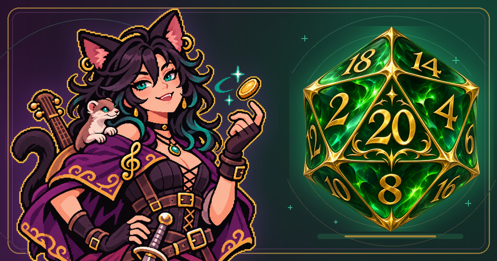

# ChaoN-USB branding

ChaoN expands to **Chaotic Neutral USB**. Its compact project identity is the **emerald-and-gold natural-20 d20**, and its approved illustrated mascot is **Sara, a charismatic pixel-art rogue-bard with a weasel familiar**.

The [visual direction](../branding.md) describes the color and typography system. The SVG marks are deliberately separate from the original illustrated d20 and mascot.

## Asset inventory

These three **approved original PNG binaries are committed in this directory**. Dimensions, pixel modes, byte lengths and SHA-256 digests below were independently inventoried at review head `ee31df2661d5d3dc664b4dea18b63fc1a61f82fe`; re-verify before claiming identity after any future changes.

| File | Size | Mode | Bytes | SHA-256 |
| --- | --- | --- | ---: | --- |
| [Emerald ornate d20](emerald_gold_filigree_d20.png) | 1254 × 1254 | RGBA | 2,112,305 | `56171f49cbdd8419108190bb0edf4b4f78bc50e204312fd3d839e0eddba3312d` |
| [Sara rogue-bard mascot](pixel_catgirl_bard_with_ferret_familiar.png) | 1254 × 1254 | RGBA | 1,767,920 | `3a4245b69305c2f52fb2ebb8d0cf507b2de2eae3a1159114f481915cc217a918` |
| [Social preview](social-open-graph-1200x630.png) | 1200 × 630 | RGB | 876,287 | `d2bdbc5e14eade216e4ccdc5fabedadfc49df7aa6b058da8d48cbd280e642b5d` |

The mascot source filename retains **ferret** for reproducibility, but the established character familiar is a **weasel**. Do not silently rename or regenerate approved binary assets.

### Vector assets

- [`assets/chaon-logo.svg`](../../assets/chaon-logo.svg): restrained horizontal README header/wordmark with triangular d20 face and outlined number.
- [`assets/chaon-d20.svg`](../../assets/chaon-d20.svg): simplified stand-alone d20 supporting icon for larger sizes. At 16 px, use an appropriately validated simplified mark rather than assuming the numeral remains readable.

Both SVGs are project-authored vector graphics, **not** pixel-for-pixel conversions of the original ornate d20 PNG.

### GitHub social-preview deployment

The 1200 × 630 PNG is available in the repo, but **committing the image does not activate GitHub's social-preview setting**. Upload/apply it separately in GitHub's repository settings with explicit maintainer authorization. The approved image currently prioritizes Sara and the d20; it has no project-name wordmark. This is an intentional design limitation to consider when reviewing link-sharing appearance.

## Artwork rights and license status

The repository's `LICENSE` remains **AGPL-3.0-only** for code, documentation, and previously included vector artwork to the extent the contributors hold licensable rights. The **three new PNGs in the table above are expressly excluded from the repository's blanket AGPL artwork statements pending rights confirmation**. Their presence in a public repository is **not** an affirmative open-content or commercial-use license grant.

**CC BY-NC 4.0 is a proposed future license, not currently effective.** The intended direction, analogous to ScanLab's still-pending artwork policy, is to welcome attributed noncommercial fan adaptations of rights-cleared original images while requiring separately granted commercial permissions. Do not represent this intention as adopted, enforceable in all jurisdictions, or sufficient to restrict uses of AI-generated elements that may not qualify for copyright protection. Before adopting a separate license, verify applicable OpenAI output terms, provenance, human creative contributions, authority to license, co-maintainer approval and the exact covered files. The legal effect of any rights carve-out and existing repository history also deserves maintainer/legal review.

Names, marks, affiliation and endorsement rights are separate from copyright licensing. The two SVGs are part of the existing AGPL-covered project vector assets unless an authorized later decision explicitly changes their treatment.

## Presentation rules

Keep the README banner restrained and follow it immediately with the product's purpose and safety limitations. Use the d20 as a compact mark and Sara for richer promotional/social artwork; never squeeze the full mascot into a favicon. Preserve the original generated PNGs, independently compare changes before replacing them, and maintain an honest distinction between stored images and activated platform settings.
